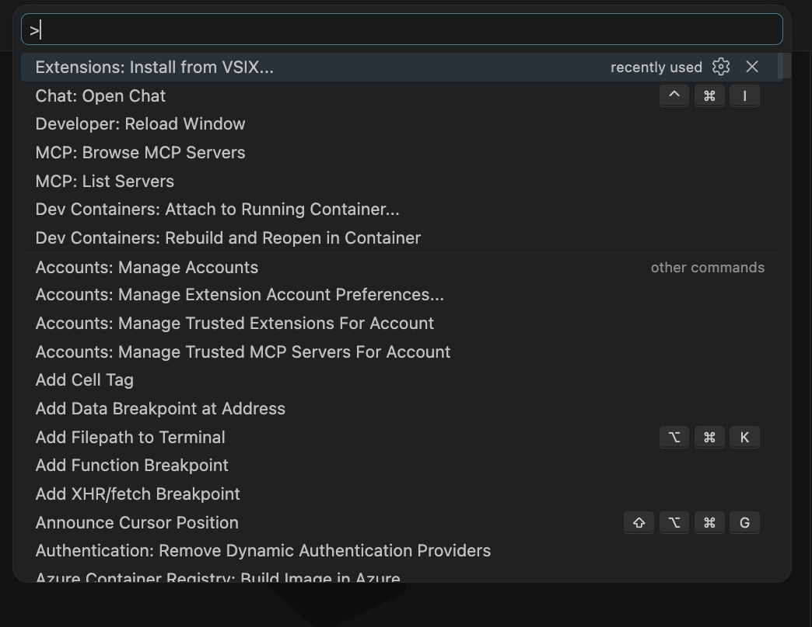
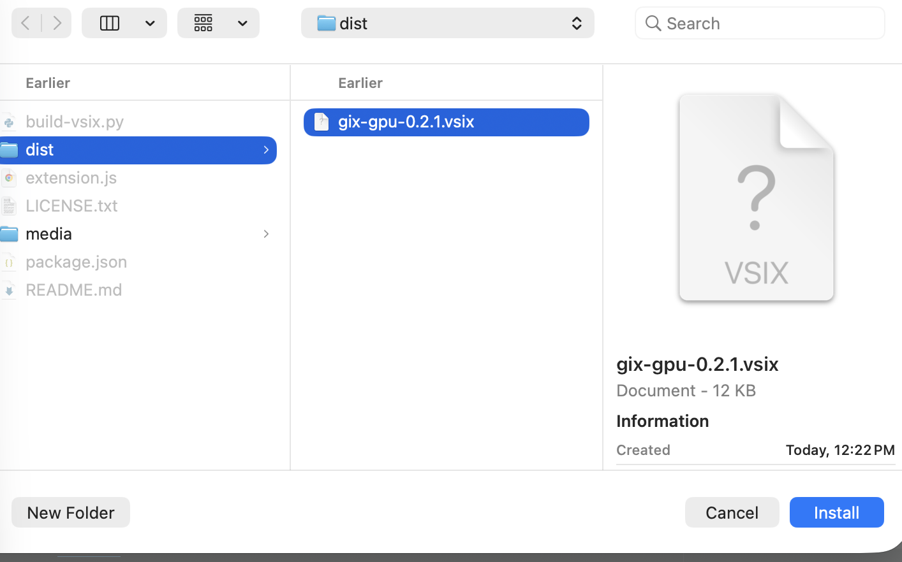
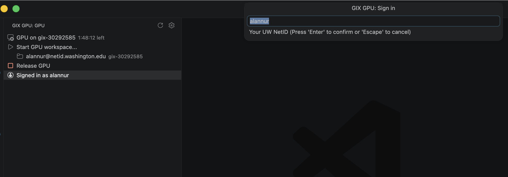
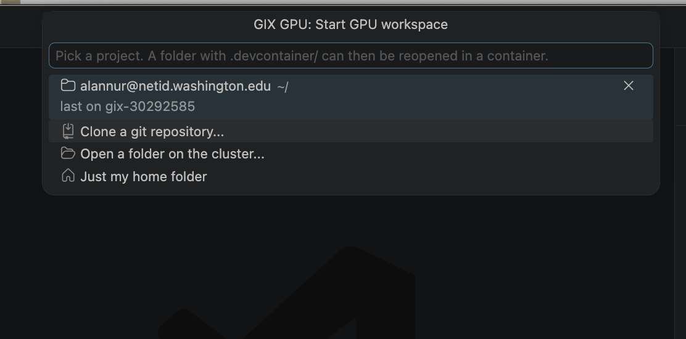

# GIX GPU

Open any project with a `.devcontainer/` on a GIX RTX 5090 from VS Code: course repos, research
code, your own experiments. You need to be on **UW IoT**.

See **Install** and **How to use** below for a step by step walkthrough.

Projects live in your home folder on the GPU node. Each node has its own disk, so the extension
asks for the node your project was on last time; if that one is busy you get another node and a
notice. Keep your work in git so you can continue anywhere.

Settings (gear icon in the GIX panel): quarter or whole GPU, CPUs, RAM, time limit, idle release.

Devcontainer rules on the cluster: use `--device=nvidia.com/gpu=all` (not `--gpus`), add
`--userns=keep-id:uid=1000,gid=1000` and `"updateRemoteUserUID": false`; no `--privileged`,
`/dev` mounts or `docker.sock`; Docker Compose devcontainers are not supported.

## Install

1. Download `dist/gix-gpu-<version>.vsix` from this repo.
2. In VS Code open the Command Palette (`Cmd/Ctrl+Shift+P`) and run **Extensions: Install from VSIX...**

   

3. Select `gix-gpu-<version>.vsix` and click **Install**. Remote - SSH and Dev Containers are installed with it.

   

## How to use

Make sure you are on **UW IoT**.

1. **Sign in.** Click the **GIX GPU** icon in the left bar, then **Sign in with NetID**. Type your
   UW NetID and press Enter, then enter your NetID password once in the terminal that opens.
   After that the panel shows **Signed in as <netid>**.

   

2. **Start a GPU workspace.** Click **Start GPU workspace...** and pick a recent project,
   **Clone a git repository...**, **Open a folder on the cluster...**, or **Just my home folder**.
   The first time, it waits until Slurm gives you a GPU. When it is ready the panel shows
   **GPU on gix-<job id>** with the time left.

   

3. **Reopen in container.** If the folder has a `.devcontainer/`, VS Code offers
   **Reopen in Container**. Click it.
4. **Release the GPU.** Done? Just close VS Code. The GPU is released after 30 idle minutes, or
   right away with **Release GPU** in the panel (or status bar -> GIX).

## Build

No npm needed: `python3 build-vsix.py` packs `gix-gpu-<version>.vsix` from this folder.

## How it works

The extension only drives plain OpenSSH and VS Code's Remote-SSH / Dev Containers. On the cluster,
`gix-devjob` (the SSH ProxyCommand on the login host) gets or reuses a Slurm job and connects to the
node Slurm picked; `pam_slurm_adopt` puts the SSH session, VS Code server and rootless Podman
containers inside that job, so its GPU/CPU/RAM limits apply.
